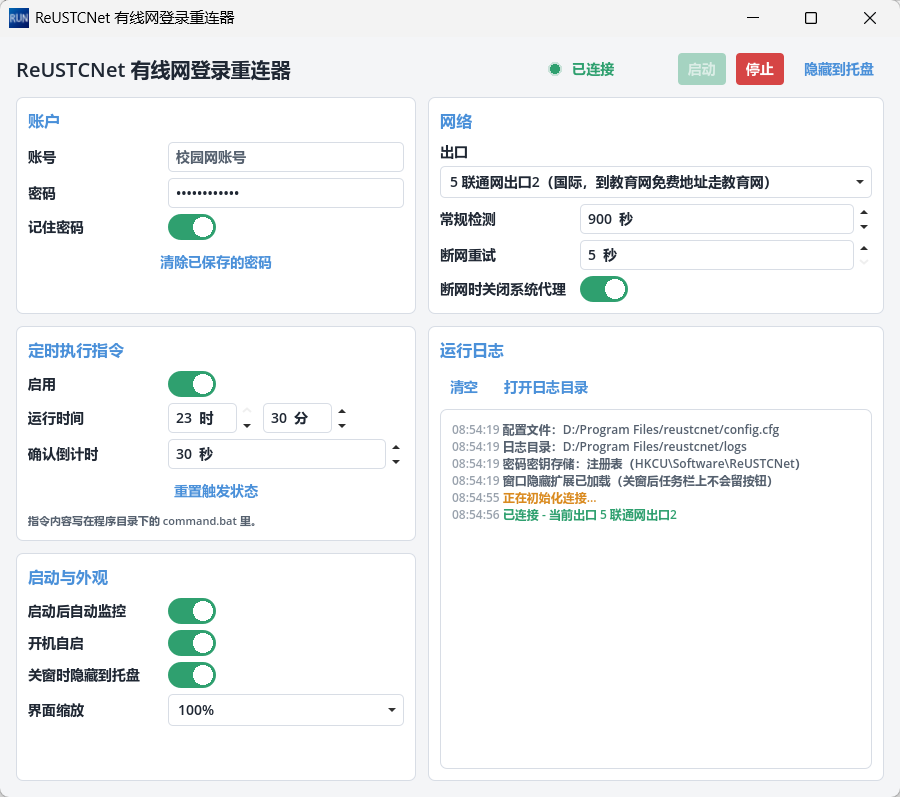

<p align="center">
  
</p>

<h1 align="center">ReUSTCNet — 中国科大有线网自动登录与断线重连工具</h1>

<p align="center">
  <a href="LICENSE"></a>
</p>

针对 **中国科学技术大学（USTC）有线网络** [`wlt.ustc.edu.cn`](http://wlt.ustc.edu.cn) 的后台自动登录与断线保持工具。
登录一次之后常驻后台：断线自动重连、保持出口开通，支持开机自启、系统托盘、定时执行指令，密码加密存储。

界面用 **Godot 4.7**（纯 GDScript）实现，**没有 Python 后端、目标机器不装任何运行时**——交付一个 exe 就能跑。
整个界面由一套集中管理的设计令牌（`scripts/theme/theme_palette.gd`）驱动全局样式：颜色、字号、圆角、间距改一处即全界面生效。

## 截图



## 功能

- 自动登录并选择出口（教育网、电信、联通、移动等 9 个出口）
- 断线自动重连：常规检测与快速重试双模式，间隔可调
- 顶部状态灯 + 短状态文字实时反映连接情况（「已连接 / 重连中 / 未启动」），完整消息进运行日志
- 系统托盘：关闭窗口**从任务栏上收起来**（不是最小化），托盘菜单可显示主界面 / 启停监控 / 退出
- 断网时自动关闭 Windows 系统代理（可选，联网后不自动恢复）
- 定时执行指令：到点执行程序目录下的 `command.bat`，可配确认倒计时（见下文）
- 开机自启：用「启动」文件夹里的快捷方式，**不写注册表**（避免被杀软拦截）
- 密码 AES-256 加密存储，密钥绑定当前 Windows 用户（见「密码安全」）
- 单实例运行；重复启动会把已有窗口叫到前台
- 界面缩放手动档位（跟随系统 / 100%～200%，**默认 100%**）
- 运行日志可回看、选中复制，自动跟随最新一行；另有按天轮转、自动清理的日志文件

> **开机自启**用的是「启动」文件夹里的快捷方式
> （`%APPDATA%\Microsoft\Windows\Start Menu\Programs\Startup\ReUSTCNet.lnk`），
> 不是注册表 `Run` 键——那个位置是杀软启发式的重灾区，没有签名的 exe 写进去容易被拦。
> **开关默认是关的**，程序不会自己打开它；从旧版升上来的话，遗留的注册表项会在
> 第一次启动时被静默清掉。

## 快速开始

### 直接运行（已打包）

从 [Releases](https://github.com/distanrive/ReUSTCNet/releases) 下载最新的压缩包，解压后双击 `ReUSTCNet.exe`。
首次使用需输入账号密码，勾选「记住密码」后自动加密保存。

发布包是**三个文件**，缺一不可，要放在同一个目录：

| 文件 | 作用 |
| --- | --- |
| `ReUSTCNet.exe` | 程序本体 |
| `ReUSTCNet.pck` | 项目数据（缺了起不来） |
| `native_window.windows.x86_64.dll` | 让「关窗后从任务栏消失」成为可能（缺了退化成最小化） |

> 如果 Windows 弹出「Windows 保护了你的电脑」，点「更多信息」→「仍要运行」。
> 这是没有代码签名证书的常见提示，不是程序有问题。

### 从源码运行

需要 **Godot 4.7.x 标准版**（GDScript，非 .NET）。用 Godot 打开本目录按 **F5** 即可，没有其他依赖。

```bash
godot --path .                           # 正常打开界面
godot --path . --quit-after 120          # 无人值守跑一遍，看有无报错
```

命令行 `--` **之后**才是本程序的参数（`OS.get_cmdline_user_args()`）：

```bash
godot --path . -- --ui-scale=1.5         # 临时指定界面缩放（不写回配置）
godot --path . -- --reset-window         # 忽略记住的窗口尺寸，按默认尺寸开一次
godot --path . -- --no-instance-guard    # 关掉单实例保护（同时开多个实例做对比时用）
```

> 主程序已经在跑的时候再启动一次，新进程只会把已有窗口叫到前台然后自己退出（单实例保护）。

### 自检（开发用）

平台相关的部分（编码解码、表单编码、会话 cookie、密码加解密、注册表读写、自启快捷方式、
过期日志清理）、两个「错了也不报错」的界面控件（滚动条宽度、日志裁剪与转义）、
以及原生窗口扩展（能否加载、隐藏是否真生效）都有一份自检：

```bash
godot --headless --path . --script res://tools/self_check.gd

# 原生扩展那一项要在窗口模式下才会真跑（headless 下没有窗口系统，会跳过）：
godot --path . --script res://tools/self_check.gd
```

它只碰本程序自己的注册表键（`HKCU\Software\ReUSTCNet*`），跑完清理干净，
**不会动系统代理或任何其他设置**。退出码 0 = 全通过。

## 定时执行指令

1. 在界面「定时执行指令」卡片勾选「启用」，设置**运行时间**（24 小时制）与**确认倒计时**（秒）。
2. 在程序目录下新建 `command.bat`，写入要定时执行的指令，例如：

   ```batch
   @echo off
   shutdown /s /t 0
   ```

3. 到点后弹出确认倒计时窗口，环形进度条走完（或长按「立即执行」1 秒）后执行 `command.bat`。
4. 若程序目录下没有 `command.bat`，会提示并跳过本次执行。

**确认倒计时 = 0** 是「无人值守」档位：到点**直接执行**，不弹窗，也不会把窗口从托盘里叫回来。

> 窗口藏在托盘里时，非 0 的倒计时会**自动把主界面叫回前台**——否则你看不到弹窗，既不知道也没法取消。
> 「立即执行」是长按按钮（按住 1 秒），因为 `command.bat` 里常写的是 `shutdown` 这类不可撤销的指令。

同一分钟只触发一次；**点「取消」不算已触发**，当天还能再响，也可以点「重置触发状态」手动清掉记录。

## 配置说明

配置默认写在**程序所在目录**（绿色版；开发期就是工程目录）。若该目录不可写（比如装在
`C:\Program Files` 下），会自动退到 `%APPDATA%\Godot\app_userdata\ReUSTCNet\` 并在启动日志里提示。
界面日志区头几行会打印实际使用的路径。

配置文件是 Godot 的 `ConfigFile` 格式（`config.cfg`），业务字段在 `[app]` 段：

| 字段 | 说明 |
| --- | --- |
| `username` | 校园网账号 |
| `password` | 加密后的密码（`enc:` 前缀 + base64） |
| `export_type` | 出口编号：0-教育网, 1-电信网, 2-联通网, 3-电信网2, 4-联通网2, 5-电信网3, 6-联通网3, 7-教育网2, 8-移动网 |
| `fast_retry_interval` | 断网时快速重试间隔（秒，默认 60） |
| `normal_check_interval` | 联网正常时检测间隔（秒，默认 900） |
| `remember_password` | 是否把密码写进配置文件（关闭时密码只在本次运行期间保留） |
| `auto_close_proxy` | 断网时是否自动关闭 Windows 系统代理 |
| `auto_command` | 是否启用定时执行指令 |
| `command_hour` / `command_minute` | 指令运行时间（24 小时制） |
| `command_countdown` | 执行前确认倒计时（秒）。**0 = 到点直接执行、不弹任何窗口** |
| `command_last_triggered` | 上次**已执行**的时刻（`YYYY-MM-DD HH:MM`），防止重启后同一分钟重复触发 |
| `auto_start_monitor` | 启动后是否自动开始监控 |
| `minimize_to_tray` | 关闭窗口时是否隐藏到托盘（关掉则点关闭直接退出） |

同一文件里还有 `[ui]`（缩放）与 `[window]`（窗口尺寸/最大化）两个段，由程序自己维护：

- `[ui] scale` 缺省 **100%**；写成 `0.0` 才表示「跟随系统 DPI」。
- `[window]` 记的是**你上次拖成的窗口大小**，优先于内置默认值；想按默认尺寸重开一次用 `--reset-window`。

### 从旧版 Python 程序迁移

首次运行会自动读取程序目录下的旧 `config.json`，导入**非密码**字段并把文件改名为
`config.json.imported`（不删除）。**密码导不过来**——旧版存的是 Windows DPAPI 密文，需要重新输入一次。

## 密码安全

- 密码用 **AES-256-CBC** 加密后存进配置文件，每份密文带随机 IV。
- 密钥是一串 32 字节随机数，首次运行时生成，存在 `HKCU\Software\ReUSTCNet`（**只当前用户可读**）。
- 因此**配置文件被单独拷走也解不出密码**——密钥不在文件里，在这台机器的注册表里。
- 明文密码只在内存中短暂存在（登录时用），不写日志、不显示在界面。
- 点「清除已保存的密码」可彻底删除配置文件里的密码。

> 与旧版 DPAPI 的差别：能读到你当前 Windows 账户注册表的人，密钥和密文就一起拿到了。
> 两种方案都挡不住「登录了你账户的攻击者」，区别只在「配置文件单独泄漏」这一种情况——那种情况两者都防得住。
> 若注册表不可写，密钥会**降级**成程序目录下的 `.key` 文件（安全性低于注册表），启动日志里会有明确警告。

## 资源占用

这是个常驻后台的监控工具，所以特意把资源占用压得很低：

| 优化 | 手段 |
| --- | --- |
| 渲染器 | 用 **Compatibility（OpenGL 3）** 而不是默认的 Forward+。官方文档对 2D/UI 应用的建议就是它——基础开销最低。实测内存从 **407 MB 降到 126 MB**，空闲 GPU 从 **28.6% 降到 0.2%** |
| 低处理器模式 | `low_processor_mode` 开启：**内容没变就不重绘**，空闲时几乎不碰 GPU |
| 隐藏到托盘 | 藏起来后把帧率压到 10，并**停掉根窗口的渲染更新**——待机一天也不烤 GPU |

用户实测：内存 < 100 MB，隐藏到托盘后 GPU < 0.5%。

## 工作原理

1. 启动后，若「启动后自动监控」开启且账号密码已填，自动开始监控。
2. 首次连接依次：读取本机 IP →（必要时）登录 → 开通网络（选出口）。
3. 联网成功后进入常规检测（默认每 900 秒一次）：读 `cmd=disp` 检查页面是否含 `权限: 国际`。
4. 检测到断网立即重连，切到快速重试模式（默认每 60 秒一次）直到恢复。
5. 监控循环是**主线程上的一条协程**（`scripts/core/net_monitor.gd`），靠 `await` 等 HTTP 与计时器，
   没有后台线程——所以「停止」能在 0.25 秒内真正停下来。

### 两个移植时最容易踩的坑

**中文页面的编码。** `wlt.ustc.edu.cn` 的响应头不带 charset，页面里写着 `charset=gb2312`，
而所有「是否登录成功 / 出口是否开通」的判据都是中文串比对——编码一旦解错，判据会**静默失效**
（表现为「网络明明好的却一直报断网」）。`decode_body()` 的处理顺序：

1. 页面声明的 charset 是权威依据——但 Windows 上只有 `gb2312` / `gb18030` 有效，`936` / `GBK` 会返回空串；
2. 字节本身是合法 UTF-8（且含多字节）就直接按 UTF-8 解——兜住「没声明」和「声明写错」；
3. 解出来有替换字符（`�`）就换另一种再试。

**登录后的会话 cookie。** 登录成功会带一个 `Set-Cookie: rn=...`，之后的 `cmd=disp` / `cmd=set`
**必须带回去**——不带，服务端就把你当匿名访客、原样返回登录页，而且**不报错**（HTTP 还是 200，
只有判据对不上）。浏览器和 `requests` 这类库自动带 cookie，用 Godot 的 `HTTPRequest` 就得自己存
（`_remember_cookies()` / `_cookie_header()`）。自己写客户端适配别的学校时这条最容易漏。

## 目录结构

```
.
├── project.godot                 # 工程配置 + autoload
├── native_window.gdextension     # 原生窗口扩展的清单
├── scenes/app.tscn               # 主场景
├── scripts/
│   ├── app.gd                    # 主界面：建界面 / 绑定配置 / 接核心逻辑的信号
│   ├── autoload/                 # theme_manager / app_shell / app_config / instance_guard
│   ├── theme/                    # theme_palette（设计令牌）+ theme_factory（构建 Theme）
│   ├── ui/                       # 可复用控件（StatusDot / Switch / TitledGroup / LogView / …）
│   └── core/                     # 纯逻辑，不引用任何 UI
│       ├── wlt_client.gd         # 取 IP / 登录 / 开通出口 / 检测 + 响应解码
│       ├── net_monitor.gd        # 监控状态机（协程）
│       ├── secret_store.gd       # 密码加解密
│       ├── win_registry.gd       # 注册表读写（reg.exe）
│       ├── win_system.gd         # 开机自启、系统代理开关
│       ├── win_shell.gd          # 起进程（含 PowerShell）
│       ├── command_scheduler.gd  # 定时执行指令
│       └── log_store.gd          # 日志落盘 + 轮转 + 清理
├── themes/icons/                 # 控件图标
├── bin/                          # 原生扩展的产物（*.dll）
├── tools/                        # 自检 / 编译模板 / 原生扩展源码
├── docs/code-review.md           # 旧版 main.py 的审阅记录
└── README.assets/                # 截图
```

## 打包

一键脚本：

```bat
build.bat              :: 导出 release + 冒烟测试 + 压 rar
build.bat debug        :: 导出 debug 版（带 console 包装，能看 print）
build.bat run          :: 导出后直接启动 exe
build.bat test         :: 只导出 + 冒烟测试
build.bat templates    :: 列出已安装的导出模板
```

配置在 `build_config.bat`（Godot 路径、预设名、是否压包、是否编原生扩展），换机器只改这一个文件。

### 关于体积与自定义模板

exe 那几十 MB 全是 Godot 引擎本体（本项目数据只有约 190 KB），调资源/导入设置没用，
只能**自己编译精简模板**。本项目把官方模板 104 MB 压到了 **29.4 MB**（发布包 7.5 MB）：

1. **关模块与引擎特性**（3D、音频、导航、XR、物理、多人联机、SDL 手柄输入……），
   保留 SVG、WebP、高级文本服务器（中文）、glslang、freetype、OpenGL 驱动；
2. **类级裁剪**——用编辑器的 Engine Compilation Configuration Editor 生成 `.gdbuild`，
   把用不到的引擎类整个编掉（再省 7.8%）。

> ⚠️ **不能用官方模板直接导出。** 编译脚本会先给 Godot 源码打一个补丁（`tools/patch_godot_chunked.py`）：
> `wlt.ustc.edu.cn` 的响应是分块传输，而它的**分块长度行末尾多一个空格**（`8c \r\n`，
> RFC 只允许十六进制数字）。curl / Chrome / Python 都容错，Godot 4.7 是严格的，见到空格直接判
> 「连接被断开」——官方模板导出的 exe **连不上校园网**，而且报错看着像网络故障。

重新编译模板的完整步骤、每次重编译要核对的清单，见 `CLAUDE.md` 的「打包」一节。

## 适配其他学校

此工具针对 USTC 网络环境，改 `scripts/core/wlt_client.gd` 即可适配其他校园网。
需抓取并修改的内容（用浏览器 F12）：

| 项目 | 说明 |
| --- | --- |
| **登录 / 开通网络 URL** | `BASE_URL`、`login()` / `activate()` 的参数 |
| **成功判断文本** | `MARK_*` 一组常量（如「登录成功」「权限: 国际」） |
| **IP 提取** | `_extract_ip()` |
| **页面编码** | `decode_body()` 的 charset 分支 |
| **表单编码** | `_percent()`（本项目站点是 GB2312 页面） |
| **会话 cookie** | 登录响应的 `Set-Cookie` 必须存下来、后续请求带回去（最容易漏，见「工作原理」） |
| **CSRF Token**（如有） | 某些系统需先取 Token，可在 `_request()` 前加一次预请求 |

改完记得跑自检（`tools/self_check.gd` 里的编解码期望值也要跟着改）。欢迎提 PR 增加其他学校的适配。

## 致谢

- [Godot Engine](https://godotengine.org/) — 界面与运行时（MIT）
- 界面与主题体系裁剪自 [Godot4GUI](https://github.com/distanrive/Godot4GUI)（上游模板项目）

## 开源许可

本项目采用 [MIT License](LICENSE)，允许自由使用、修改和分发，详见 LICENSE 文件。
